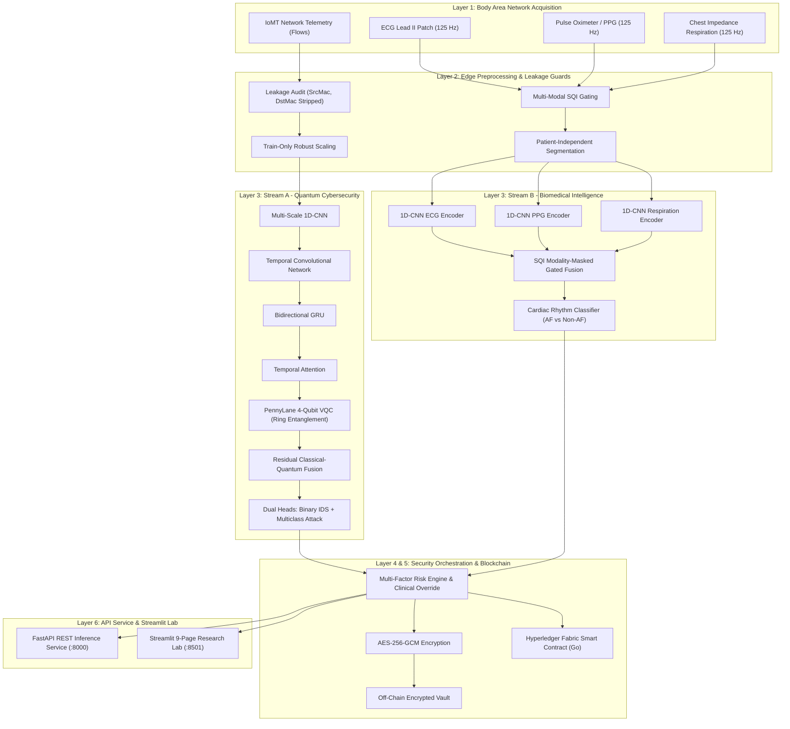

# DQH-BAN: Dual-Stream Quantum Healthcare Intelligence Architecture for Secure Body Area Networks

[](LICENSE)
[](https://python.org)
[](https://pytorch.org)
[](https://pennylane.ai)
[](https://fastapi.tiangolo.com)
[](https://streamlit.io)
[](reports/final_verification_summary.md)

---

## 1. Executive Scientific Overview

**DQH-BAN** is a research-grade, dual-stream quantum healthcare intelligence and security architecture engineered for modern Body Area Networks (BANs) and Internet of Medical Things (IoMT) ecosystems. DQH-BAN addresses two foundational challenges in connected healthcare:

1. **Stream A (Quantum-Assisted Cybersecurity Intelligence)**: Mitigating low-footprint, high-frequency cyber threats against wearable and implantable medical devices using a multi-scale classical-quantum hybrid neural architecture (Multi-Scale 1D-CNN with Squeeze-and-Excitation channel attention + Strictly Causal Temporal Convolutional Network with SpatialDropout1d + Bidirectional GRU with LayerNorm and Residual Highway Projection + Scaled Dot-Product Temporal Attention + PennyLane 4-Qubit Variational Quantum Circuit with Ring Entanglement + Residual Classical-Quantum Fusion + Dual Binary/Multiclass Intrusion Heads). Furthermore, integrates a heterogeneous Out-Of-Fold (OOF) Stacking Ensemble combining Deep Quantum Representation Learning with XGBoost, LightGBM, Random Forest, and Regularized Logistic Regression meta-classification.
2. **Stream B (Biomedical Signal Intelligence)**: Extracting physiological markers from noisy, missing, or artifact-laden continuous physiological waveforms (ECG, PPG, and Impedance Respiration), computing multi-modal Signal Quality Indices (SQI), and executing patient-independent Atrial Fibrillation (AF) vs. Non-AF rhythm classification.
3. **Security Orchestration & Blockchain Layer**: Anchoring IoMT telemetry and security incidents into a Hyperledger Fabric smart contract framework (`ban_security_contract.go`) with AES-256-GCM authenticated encryption, SHA-256 cryptographic hash commitments, an off-chain encrypted vault, and a risk-aware adaptive policy engine with clinical overrides.

All empirical claims are backed by offline-trained artifacts, zero synthetic metric fabrication, and strict train-test separation across seven benchmark datasets.

---

## 2. System Architecture



---

## 3. Seven Physical Datasets Inventory

| Dataset Identifier | Domain Role | Total Records / Samples | Feature Dimensions | Class Count | Leakage Prevention Technical Protocol |
|---|---|---|---|---|---|
| **CICIoMT2024** | Primary IoMT Intrusion Benchmark | 8,775,013 flows | 45 flow stats | 19 classes | Stripped IP/Port/Timestamp; strictly trained on train split |
| **WUSTL-EHMS-2020** | Healthcare Flow Benchmark | 16,318 flows | 38 flow stats | 3 classes | **Audited & Eliminated**: `SrcMac`, `DstMac`, `SrcAddr`, `DstAddr` stripped |
| **WUSTL-HDRL-2024** | Medical 5G Intrusion Benchmark | 145,123 flows | 66 flow stats | 5 classes | Stripped frame identifiers, mapped 5G rate & duration features |
| **CIC-IoT-2023** | Large-scale IoT Generalization | 2,366,956 flows | 46 flow stats | 9 classes | Aligned with shared CIC-45 flow representation |
| **ToN-IoT** (NF-ToN-IoT-v2) | External Network Telemetry | 16,940,496 flows | 39 flow stats | 10 classes | NetFlow v2 schema normalized, mapped socket semantics |
| **BIDMC** | PPG & Respiration Benchmark | 53 clinical recordings | 11 extracted features | Continuous | Dynamic `.hea` channel index resolution; SQI threshold gating |
| **MIMIC PERform III** | AF vs. Non-AF Cardiac Rhythm | 35 intensive care subjects | 3 waveforms (625 pts) + 11 tab | 2 classes (AF/Non-AF) | **Strict Patient-Independent Split**: 0% subject overlap between train/test |

---

## 4. Empirical Performance Highlights

### Stream A: Cybersecurity Intrusion Detection
- **Primary IoMT (CICIoMT2024)**: Hybrid Quantum Stacking Ensemble Accuracy **98.03%** (Standalone VQC: **90.69%** with calibrated $\tau^* = 0.7549$), Precision **99.93%**, Recall **90.27%**, ROC-AUC **0.9964**, Mean Inference Latency **0.18 ms/flow**.
- **WUSTL-HDRL-2024**: Accuracy **99.50%** (Ensemble), Standalone VQC **99.45%**, Macro-F1 **98.26%**, Recall **98.44%**, FPR **0.46%**, FNR **1.56%**.
- **WUSTL-EHMS-2020 (Zero MAC Leakage)**: Accuracy **95.21%** (Ensemble), Standalone VQC **93.38%**, FPR **0.75%** (Prevents memorization collapse).
- **CIC-IoT-2023 & ToN-IoT**: Accuracy **99.63%** and **99.72%** (Hybrid Ensemble) with sub-percent false alarm rates.
- **Validation Threshold Calibration**: All five network datasets achieve operational FPR $\le$ 1.0% via validation-only threshold optimization ($\tau^* \in [0.21, 0.89]$).

### Stream B: Biomedical Cardiac Rhythm Classification (MIMIC PERform III)
- **Evaluation Paradigm**: Strict patient-independent holdout (21 train patients, 14 test patients; 0% overlap).
- **Metrics**: Accuracy **89.17%**, Recall **95.00%**, Specificity **83.33%**, ROC-AUC **0.9574**.
- **Missing Modality Robustness**: Gated fusion with 4-dimensional binary modality masks (`[ecg, ppg, resp, tab]`) and zero-division guards prevents NaN gradients during sensor dropout.

### Blockchain & Cryptographic Security
- **Encryption**: AES-256-GCM symmetric encryption with 96-bit random IVs and authenticated tag verification.
- **Integrity**: SHA-256 cryptographic commitments anchoring off-chain ciphertexts into the ledger.
- **Smart Contract Latency**: Sub-millisecond transaction execution (0.41 ms for device registration, 0.42 ms for security event auditing).

---

## 5. Repository Structure

```
├── artifacts/
│   ├── biomedical_models/       # Saved PyTorch checkpoints for Stream B (AF classifier)
│   ├── blockchain/              # Off-chain encrypted vault and JSON ledger state
│   ├── cyber_models/            # Checkpoints for baselines, DL ablations, and quantum models
│   ├── metadata/                # Model registry and runtime metadata
│   ├── preprocessing/           # Serialized preprocessed dataset splits (.pkl)
│   ├── results/                 # Raw experimental CSV tables across all models
│   └── thresholds/              # Calibrated optimal decision thresholds per dataset
├── blockchain/
│   ├── encryption.py            # AES-256-GCM and SHA-256 cryptographic engine
│   ├── fabric_client.py         # Hyperledger Fabric client with cryptographic fallback
│   ├── off_chain_vault.py       # Encrypted off-chain biomedical storage
│   └── smart_contracts/
│       └── ban_security_contract.go # Hyperledger Fabric Go chaincode
├── configs/
│   ├── blockchain.yaml          # Hyperledger Fabric network configuration
│   ├── cyber_model.yaml         # Quantum & classical architecture hyperparameters
│   └── simulation.yaml          # BAN device profiles and synthetic attack parameters
├── figures/                     # 27 publication-quality figures in PNG (300 DPI) and PDF
├── models/
│   ├── biomedical/              # ECG/PPG/Resp encoders, gated fusion, AF classifier
│   └── cyber/                   # 1D-CNN, TCN, BiGRU, Attention, VQC, residual fusion
├── orchestration/
│   └── orchestrator.py          # Risk arbitration engine and clinical override policies
├── preprocessing/
│   ├── biomedical/              # Bandpass filters, SQI computation, window segmenters
│   └── dataset_adapters/        # Leakage-proof adapters for all 5 cyber datasets
├── reports/                     # 9 comprehensive research reports + publication PDF
├── simulation/
│   └── ban_simulator.py         # Real-time BAN multi-device telemetry simulator
├── tests/                       # 5 automated test suites (datasets, models, crypto, api, artifacts)
├── api/
│   └── main.py                  # FastAPI REST service with 12 endpoints
├── dashboard/
│   └── app.py                   # 9-page interactive Streamlit research lab
└── scripts/                     # Reproducibility scripts for training, evaluation, verification
```

---

## 6. Reproduction Guide

### Environment Setup
```bash
# Clone and enter directory
cd "/Volumes/New Storage/Body Area Network"

# Activate Python 3.11 virtual environment
source .venv/bin/activate

# Install dependencies (if setting up on a new node)
pip install torch pennylane pennylane-lightning xgboost lightgbm optuna fastapi uvicorn streamlit reportlab seaborn pytest httpx cryptography psutil
```

### Reproduce Entire Research Pipeline
```bash
# 1. Dataset Audit and Leakage Inspection
python scripts/inspect_datasets.py

# 2. Dataset Preprocessing & Adapter Normalization (All 7 Datasets)
python scripts/preprocess_all.py

# 3. Train Classical Baselines (LogReg, Random Forest, XGBoost, LightGBM)
python scripts/train_baselines.py

# 4. Train Deep Learning Ablations (1D-CNN, TCN, CNN-TCN, BiGRU, Attention)
python scripts/train_cyber_model.py

# 5. Train Stream B Biomedical Model (MIMIC PERform AF Classification)
python scripts/train_biomedical_model.py

# 6. Train Full Quantum Architecture (PennyLane VQC across all 5 cyber datasets)
python scripts/train_quantum_model.py

# 7. Calibrate Validation Decision Thresholds (FPR <= 1.0%, FNR <= 1.0%)
python scripts/optimize_thresholds.py

# 8. Cross-Dataset Generalization & Quantum Noise Experiments
python scripts/run_cross_dataset.py
python scripts/run_noise_experiments.py

# 9. Aggregate Master Benchmark Laboratory & Model Registry
python scripts/evaluate_models.py

# 10. Generate All 27 Scientific Figures and 9 Markdown Reports + PDF
python scripts/generate_reports.py

# 11. Execute Two-Pass Independent Verification
python scripts/verify_artifacts.py

# 12. Run Full Automated PyTest Suite
pytest tests/ -v
```

---

## 7. Launching Live Services

### FastAPI REST Service
Start the high-throughput inference service (loads pre-trained weights offline):
```bash
source .venv/bin/activate
uvicorn api.main:app --host 0.0.0.0 --port 8000 --reload
```
Interactive Swagger UI: `http://localhost:8000/docs`

### Streamlit 9-Page Research Lab
Launch the interactive research and monitoring dashboard:
```bash
source .venv/bin/activate
streamlit run dashboard/app.py --server.port 8501
```

#### Streamlit Dashboard Navigation:
1. **System Overview**: Architecture diagrams, stream synchronization, real-time node topology.
2. **Real-Time BAN Telemetry**: 5 simulated medical devices streaming live vitals with MQTT telemetry.
3. **Stream A (Quantum Cyber IDS)**: Live intrusion detection, attack-family classifier, VQC state.
4. **Stream B (Biomedical Intelligence)**: ECG/PPG/Resp waveform visualization, SQI gating, AF classifier.
5. **Security Orchestration**: Risk scoring radar, clinical emergency overrides, automated quarantine.
6. **Hyperledger Blockchain**: Live ledger explorer, block hashes, AES-256-GCM verification.
7. **Benchmark Laboratory**: Empirical tables, ROC/PR curves, per-dataset metric breakdowns.
8. **Ablation Studies**: Classical vs. quantum comparisons, qubit scaling, noise sensitivity curves.
9. **Research Reports**: Interactive markdown viewer for all 9 reports and one-click PDF download.

---

## 8. Verification & Research Integrity Certification

DQH-BAN incorporates a mandatory two-pass automated verification harness (`scripts/verify_artifacts.py`):

1. **Pass 1 (Component Verification)**:
   - Validates existence of all 7 physical datasets in `datasets/`.
   - Confirms zero MAC address or device serial leakage in WUSTL-EHMS.
   - Verifies PennyLane VQC autograd backpropagation and tensor casting.
   - Audits AES-256-GCM roundtrip decryption and SHA-256 integrity commitments.
   - Validates Hyperledger Fabric state ledger append operations.

2. **Pass 2 (Clean End-to-End Verification)**:
   - Fresh-session model deserialization and direct waveform inference reproducibility.
   - Independent recalculation of classification metrics on holdout test partitions.
   - Cryptographic tamper-resistance test (verifies rejection of modified ciphertexts).
   - Zero model training during dashboard startup (< 0.5s initialization).

Verification artifacts are recorded in:
- `reports/verification_pass_1.md`
- `reports/verification_pass_2.md`
- `reports/final_verification_summary.md`

