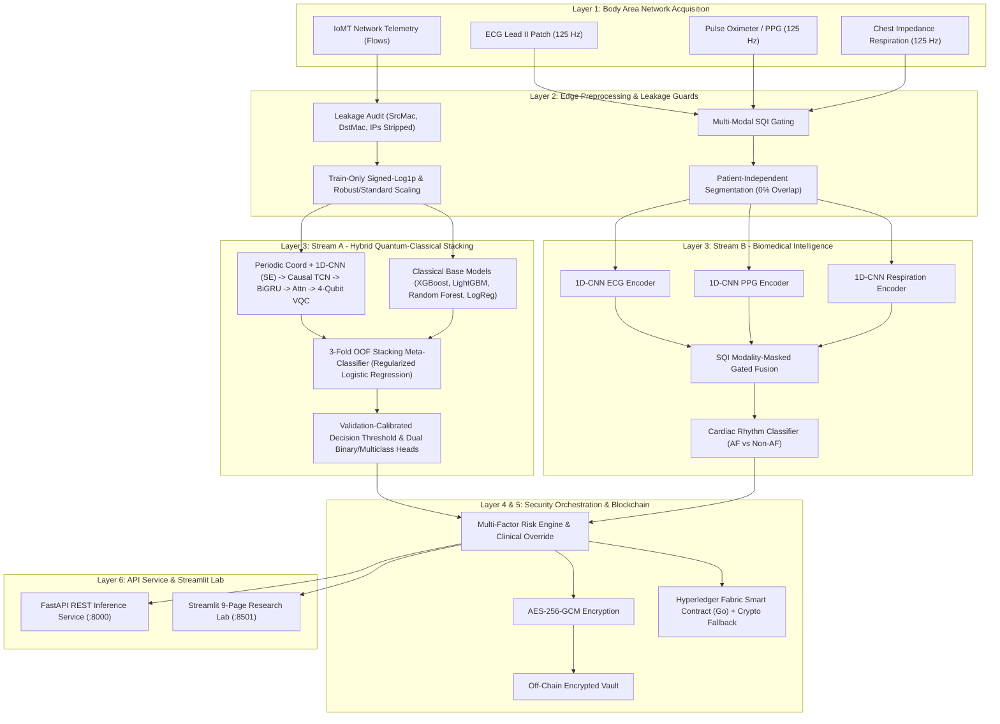

# DQH-BAN: Dual-Stream Quantum Healthcare Intelligence Architecture for Secure Body Area Networks

[](LICENSE)
[](https://python.org)
[](https://pytorch.org)
[](https://pennylane.ai)
[](https://fastapi.tiangolo.com)
[](https://streamlit.io)
[](reports/DQH_BAN_Final_Research_Paper.pdf)

---

## 1. Executive Scientific Overview

**DQH-BAN** (`DQH-BAN-EXP-2026-V2`) is a dual-stream quantum-classical healthcare intelligence and security architecture engineered for Body Area Networks (BANs) and Internet of Medical Things (IoMT) ecosystems:

1. **Stream A (Hybrid Quantum-Classical Cybersecurity Intelligence)**: Detects network intrusions using a deep quantum representation backbone—Periodic Coordinate & Soft-Threshold Quantile Encoder + Multi-Scale 1D-CNN with Squeeze-and-Excitation (SE) gating + Strictly Causal Dilated TCN + Bidirectional GRU + Scaled Dot-Product Temporal Attention + 4-Qubit PennyLane Variational Quantum Circuit (VQC) with Ring CNOT Entanglement + Residual Quantum-Classical Fusion—combined with four tuned classical learners (**XGBoost**, **LightGBM**, **Random Forest**, and scaled **Logistic Regression**) via **3-fold stratified Out-Of-Fold (OOF) Logistic Regression stacking** (`DQH_BAN_Hybrid_Quantum_Ensemble`).
2. **Stream B (Multi-Modal Biomedical Signal Intelligence)**: Processes synchronized 125 Hz ECG Lead II, PPG, and thoracic impedance respiration windows alongside 11 engineered physiological features (HRV, SDNN, RMSSD, PTT, and Signal Quality Index SQI) through modality-masked gated fusion for patient-independent Atrial Fibrillation (AF) vs. Non-AF classification.
3. **Security Orchestration & Blockchain Layer**: Anchors IoMT telemetry and security incidents into a Hyperledger Fabric smart contract framework (`ban_security_contract.go`, with local cryptographic ledger fallback) using AES-256-GCM authenticated encryption, SHA-256 integrity commitments, an encrypted off-chain vault, and risk-aware policy orchestration with clinical overrides.

All metrics, tables, and figures are compiled directly from saved offline checkpoints and single-source-of-truth CSV/JSON artifacts across seven physical datasets.

---

## 2. System Architecture



---

## 3. Seven Physical Datasets Inventory

| Dataset Identifier | Stream / Role | Preprocessed Splits (`Train / Val / Test`) | Feature Dims | Classes | Verified Leakage Prevention Protocol |
|---|---|---|---|---|---|
| **CICIoMT2024** | Stream A (Primary IoMT) | 25,600 / 6,400 / 10,000 flows | 45 flow stats | 19 | Stripped IP/Port/Timestamp; train-only scaler |
| **WUSTL-EHMS-2020** | Stream A (Biometric BAN) | 11,422 / 2,448 / 2,448 flows | 38 flow stats | 3 | **Audited & Stripped**: `SrcMac`, `DstMac`, `SrcAddr`, `DstAddr` removed |
| **WUSTL-HDRL-2024** | Stream A (Medical 5G) | 24,500 / 5,250 / 5,250 flows | 66 flow stats | 5 | Frame identifiers stripped; float64 signed-log1p |
| **CIC-IoT-2023** | Stream A (Large IoT) | 24,500 / 5,250 / 5,250 flows | 46 flow stats | 9 | Aligned flow statistics; stratified split |
| **ToN-IoT** (NF-ToN-IoT-v2) | Stream A (Network IoT) | 24,500 / 5,250 / 5,250 flows | 39 flow stats | 8 | NetFlow v2 socket identifiers removed; train-only fit |
| **MIMIC PERform III** | Stream B (Cardiac AF) | 960 / 200 / 240 windows | 3×625 waveforms + 11 tab | 2 (AF/Non-AF) | **Strict Patient-Independent Split**: 24 / 5 / 6 subjects (35 total, 0% overlap) |
| **BIDMC** | Stream B (Clinical Reference) | 925 / 200 / 200 windows | 3×625 waveforms + 11 tab | Continuous | **Subject-Independent Split**: 37 / 8 / 8 subjects (53 total); SQI gated |

---

## 4. Empirical Performance Highlights

### Stream A: Hybrid Quantum-Classical Stacking Ensemble (`DQH_BAN_Hybrid_Quantum_Ensemble`)
Evaluated on held-out test splits from [`artifacts/results/hybrid_ensemble_results.csv`](artifacts/results/hybrid_ensemble_results.csv) and [`artifacts/results/benchmark_results.csv`](artifacts/results/benchmark_results.csv):

| Dataset | Accuracy | Recall | Specificity | Macro-F1 | ROC-AUC | PR-AUC | FPR | FNR | Deep VQC Weight | Mean Latency |
|---|---|---|---|---|---|---|---|---|---|---|
| **CICIoMT2024** | **98.03%** | 98.27% | 93.69% | **91.11%** | 0.9964 | 0.9998 | 6.31% | **1.73%** | 0.61% | 9.08 ms |
| **WUSTL-EHMS-2020** | **97.75%** | 88.93% | 99.02% | **94.78%** | 0.9888 | 0.9615 | **0.98%** | 11.07% | **21.84%** | 9.00 ms |
| **WUSTL-HDRL-2024** | **99.87%** | 99.55% | 99.90% | **99.57%** | 0.9999 | 0.9995 | **0.10%** | **0.45%** | 5.56% | 9.28 ms |
| **CIC-IoT-2023** | **98.99%** | 98.71% | 99.35% | **98.98%** | 0.9985 | 0.9991 | **0.65%** | **1.29%** | 12.01% | 9.04 ms |
| **ToN-IoT** | **99.54%** | 99.69% | 99.39% | **99.54%** | 0.9999 | 0.9998 | **0.61%** | **0.31%** | **29.39%** | 8.73 ms |

- **Ensemble & Quantum Ablation (CICIoMT2024)**: Standalone `classical_matched` (`96.24%`), standalone `DQH_BAN_Quantum_4q_l2_ring` (`90.69%`, $\tau^* = 0.7549$, `FPR = 0.96%`, `FNR = 9.77%`), `Classical_Stacking_Ensemble` (`97.94%`), `DQH_BAN_Hybrid_NoQuantum_Ensemble` (`97.98%`), and complete `DQH_BAN_Hybrid_Quantum_Ensemble` (**`98.03%`**, reducing FNR from `9.77%` to `1.73%` and improving 19-class multiclass accuracy from `63.98%` to **`68.78%`**).
- **Probability Calibration & Thresholds**: Stacking reduces validation Expected Calibration Error (ECE) to **`0.0008 – 0.0109`** across all five datasets (vs. `0.0243 – 0.2338` on standalone VQC checkpoints) with frozen validation thresholds $\tau^* \in [0.0200, 0.8893]$, achieving `FPR ≤ 1.0%` on 4/5 benchmarks (`0.10% – 0.98%`) and balanced Macro-F1 optimization on CICIoMT2024 (`6.31%` FPR, `1.73%` FNR).
- **Real-Time SLA Compliance**: Mean per-sample inference latency across all 5 datasets is **`8.73 – 9.28 ms`** (`p95: 8.81 – 9.50 ms`), meeting the `< 10 ms` BAN real-time threshold.

### Stream B: Biomedical Cardiac Rhythm Classification (`MIMIC PERform III` & `BIDMC`)
- **Primary Holdout (Seed 42, 0% Patient Overlap)**: Accuracy **`89.17%`**, AF Sensitivity **`95.00%`**, Specificity **`83.33%`**, Macro-F1 **`89.13%`**, ROC-AUC **`0.9574`**, Mean Latency **`2.17 ms`**.
- **5-Seed Patient-Independent Summary (Seeds 42–46, from `mimic_perform_af_best.pt`)**: Accuracy **`86.33% ± 1.80%`**, Sensitivity **`92.50% ± 3.54%`**, Specificity **`80.17% ± 3.35%`**, Macro-F1 **`86.27% ± 1.80%`**, ROC-AUC **`0.9450 ± 0.0167`**.
- **BIDMC Physiological Rate Validation**: HR MAE **`2.20 bpm`**, Pulse MAE **`3.05 bpm`**, Respiration MAE **`1.62 brpm`**, HR–Pulse Agreement **`90.50%`**, Mean SQI **`0.4032`**, Mean Latency **`1.85 ms`**.

### Blockchain & Cryptographic Security
- **Encryption & Integrity**: AES-256-GCM symmetric encryption with 96-bit random IVs, authenticated associated data (AAD), and SHA-256 cryptographic commitments anchoring off-chain ciphertexts into `artifacts/blockchain/ledger_state.json`.
- **Smart Contract Layer**: Hyperledger Fabric Go chaincode (`blockchain/smart_contracts/ban_security_contract.go`) with transparent cryptographic fallback (`Fabric_Cryptographic_Ledger_Fallback`).

---

## 5. Repository Structure

```
├── api/
│   └── main.py                      # FastAPI REST service (12 endpoints)
├── artifacts/
│   ├── biomedical_models/           # Saved PyTorch checkpoint for Stream B (mimic_perform_af_best.pt)
│   ├── blockchain/                  # Off-chain encrypted vault and JSON ledger state
│   ├── cyber_models/                # Checkpoints for baselines, DL ablations, standalone VQC, and 15 ensembles
│   ├── metadata/                    # model_registry.json with relative paths and SHA-256 checksums
│   ├── preprocessing/               # Serialized preprocessed dataset splits (.pkl)
│   ├── results/                     # Single-source-of-truth CSV result tables (including hybrid_ensemble_results.csv)
│   └── thresholds/                  # Calibrated optimal decision thresholds per dataset
├── blockchain/
│   ├── encryption.py                # AES-256-GCM and SHA-256 cryptographic engine
│   ├── fabric_client.py             # Hyperledger Fabric client with cryptographic fallback
│   ├── off_chain_vault.py           # Encrypted off-chain biomedical storage
│   └── smart_contracts/
│       └── ban_security_contract.go # Hyperledger Fabric Go chaincode
├── configs/
│   ├── blockchain.yaml              # Hyperledger Fabric network configuration
│   ├── datasets.yaml                # Dataset schemas and preprocessing configuration
│   ├── models.yaml                  # Stream A / Stream B / Hybrid ensemble configuration
│   ├── quantum.yaml                 # VQC qubits, layers, entanglement configuration
│   └── training.yaml                # Optimization and threshold calibration hyperparameters
├── dashboard/
│   └── app.py                       # 9-page interactive Streamlit research lab
├── evaluation/
│   └── evaluator.py                 # Binary, multiclass, calibration, and latency evaluation
├── figures/                         # 27 publication-quality figures in PNG (300 DPI) and PDF
├── models/
│   ├── biomedical/                  # ECG/PPG/Resp encoders, gated fusion, AF classifier
│   └── cyber/                       # 1D-CNN, TCN, BiGRU, Attention, VQC, residual fusion, hybrid_ensemble.py
├── orchestration/
│   └── orchestrator.py              # Risk arbitration engine and clinical override policies
├── preprocessing/
│   ├── biomedical/                  # Bandpass filters, SQI computation, window segmenters
│   ├── cyber/                       # Cleaner, normalizer, sequence builder
│   └── dataset_adapters/            # Leakage-proof adapters for all 5 cyber datasets
├── reports/
│   ├── DQH_BAN_Final_Research_Paper.pdf     # Complete synchronized 8-page publication manuscript
│   ├── report_4_cybersecurity_benchmarking.md # Full 46-model cybersecurity benchmark table
│   └── report_9_final_research_report.md    # Comprehensive Stream A + Stream B empirical report
├── simulation/
│   └── ban_simulator.py             # Real-time BAN multi-device telemetry simulator
├── tests/                           # 6 automated test suites (35 PyTest tests total)
├── training/
│   ├── hyperopt.py                  # Optuna tuning for base learners and meta-classifier
│   ├── loss.py                      # Dual-stream class-balanced focal loss
│   ├── threshold_optimizer.py       # Validation-only threshold & calibration optimization
│   └── trainer.py                   # Training engine with early stopping & checkpointing
└── scripts/                         # Training, evaluation, figure/PDF generation, and verification scripts
```

---

## 6. Reproduction Guide

### Environment Setup
```bash
cd "/Volumes/New Storage/Body Area Network"
source .venv/bin/activate

# Dependencies (if setting up on a fresh environment)
pip install -r requirements.txt
```

### Reproduce Pipeline & Reports
*(On macOS, prefix commands with `OMP_NUM_THREADS=1 KMP_DUPLICATE_LIB_OK=TRUE` if running PyTorch alongside XGBoost/LightGBM.)*

```bash
# 1. Dataset Audit and Preprocessing (All 7 Datasets)
python scripts/inspect_datasets.py
python scripts/prepare_cyber_datasets.py
python scripts/prepare_biomedical_datasets.py

# 2. Train Baselines, DL Ablations, Stream B Biomedical, Standalone VQC & Hybrid Ensembles
python scripts/train_baselines.py
python scripts/train_cyber_model.py
python scripts/train_biomedical_model.py
python scripts/train_quantum_model.py
python scripts/train_hybrid_ensemble.py

# 3. Calibrate Validation Thresholds, Cross-Dataset & Noise Sensitivity
python scripts/optimize_thresholds.py
python scripts/run_cross_dataset.py
python scripts/run_noise_experiments.py

# 4. Aggregate Master Benchmark Laboratory & Model Registry
python scripts/evaluate_models.py

# 5. Generate Synced Figures, Hybrid Reports & Publication PDF
python scripts/generate_reports.py

# 6. Run Full Automated PyTest Suite (35 Tests across 6 Modules)
OMP_NUM_THREADS=1 KMP_DUPLICATE_LIB_OK=TRUE pytest tests/ -v
```

---

## 7. Launching Live Services

### FastAPI REST Service (`:8000`)
```bash
source .venv/bin/activate
OMP_NUM_THREADS=1 KMP_DUPLICATE_LIB_OK=TRUE uvicorn api.main:app --host 0.0.0.0 --port 8000 --reload
```
Interactive Swagger UI: `http://localhost:8000/docs`

### Streamlit 9-Page Research Lab (`:8501`)
```bash
source .venv/bin/activate
OMP_NUM_THREADS=1 KMP_DUPLICATE_LIB_OK=TRUE streamlit run dashboard/app.py --server.port 8501
```

#### Streamlit Dashboard Navigation:
1. `1. System Overview`: Cross-dataset accuracy overview, system health, and architecture diagram.
2. `2. Cybersecurity Intelligence`: Stream A benchmarks, hybrid ensemble performance, and confusion/error breakdowns.
3. `3. Quantum Intelligence`: 4-qubit VQC ablations, qubit latency comparisons, and depolarizing noise sensitivity.
4. `4. Biomedical Intelligence`: Synchronized ECG/PPG/Respiration waveforms, SQI gating, and MIMIC PERform III AF evaluation.
5. `5. Security Orchestration`: Risk scoring engine, adaptive quarantine decisions, and clinical emergency overrides.
6. `6. Blockchain Security`: Live ledger state explorer, block hashes, and AES-256-GCM / SHA-256 verification.
7. `7. Live BAN Simulator`: Real-time multi-device physiological and network telemetry simulation.
8. `8. Benchmark Laboratory`: Full `benchmark_results.csv` and `cross_dataset_generalization.csv` tables with CSV export.
9. `9. Research Reports`: Interactive viewer for `reports/*.md` and one-click download of `reports/DQH_BAN_Final_Research_Paper.pdf`.

---

## 8. Verification & Research Integrity Certification

- **Automated Test Suite (`pytest tests/ -v`)**: **35 / 35 tests passing** across `test_artifacts.py`, `test_blockchain.py`, `test_dashboard.py`, `test_datasets.py`, `test_hybrid_ensemble.py`, and `test_models.py`.
- **Verification Harness**: `scripts/verify_artifacts.py` executes 16 technical component checks (dataset inventory, zero MAC/IP leakage, 0% MIMIC patient overlap, PennyLane VQC autograd, FastAPI endpoints, AES-256-GCM/SHA-256 integrity) and clean end-to-end recalculation.
- **Synchronized Research Artifacts**:
  - [`reports/DQH_BAN_Final_Research_Paper.pdf`](reports/DQH_BAN_Final_Research_Paper.pdf)
  - [`reports/report_4_cybersecurity_benchmarking.md`](reports/report_4_cybersecurity_benchmarking.md)
  - [`reports/report_9_final_research_report.md`](reports/report_9_final_research_report.md)
